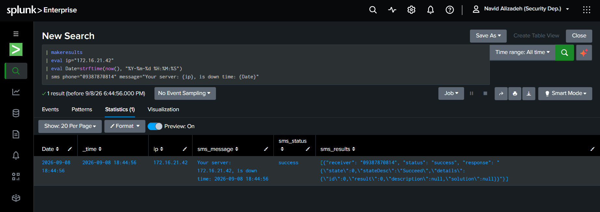

# Splunk SMS Command 📱

A lightweight custom **Splunk Streaming Search Command** for sending SMS notifications directly from Splunk searches.

The command integrates Splunk with an HTTP/REST-based SMS gateway using **JWT authentication**, allowing security teams and SOC analysts to trigger SMS notifications directly from SPL searches.

---

## ✨ Features

* 📱 Send SMS directly from Splunk SPL
* 👥 Support multiple recipients
* 🔐 JWT-based authentication
* 🔄 Automatic JWT authentication and token reuse during command execution
* 🧩 Dynamic message templates using Splunk event fields
* 🧪 Built-in `dry_run` mode for safe testing
* 🎯 `first` mode to prevent duplicate SMS notifications
* 📢 `all` mode for sending an SMS for every event
* 📊 Returns SMS execution status and results to Splunk
* ⚡ Lightweight implementation
* 🐍 Python-based Splunk custom search command
* 🔌 Designed for REST/HTTP SMS gateways
* 🔑 Credentials stored outside the Python source code

---

## 🏗️ Architecture

```text
                 Splunk Search
                      │
                      ▼
              ┌───────────────┐
              │   sms command │
              └───────┬───────┘
                      │
                      ▼
                 sms.py
                      │
              ┌───────┴───────┐
              │               │
              ▼               ▼
        JWT Authentication   Message
              │               │
              └───────┬───────┘
                      ▼
                SMS REST API
                      │
             ┌────────┴────────┐
             ▼                 ▼
          Receiver 1         Receiver 2
```

---

## 📂 Project Structure

```text
splunk-sms-command/
├── bin/
│   ├── sms.py
│   └── lib/
├── default/
│   ├── app.conf
│   └── commands.conf
├── local/
│   └── sms.conf.example
├── screenshots/
│   ├── dry-run.png
│   └── sms-success.png
├── .gitignore
├── LICENSE
└── README.md
```

---

## ⚙️ Requirements

* Splunk Enterprise
* Python 3
* An HTTP/REST SMS gateway
* SMS gateway credentials
* SMS API supporting JWT authentication
* Network connectivity from the Splunk server to the SMS gateway

The command was developed and tested with:

```text
Splunk Enterprise 10.4.2
Python 3.13.x
RHEL 9.x
```

Other Splunk versions may require compatibility testing.

---

# 🚀 Installation

## 1. Copy the application

Copy the complete application directory to:

```text
$SPLUNK_HOME/etc/apps/
```

For example:

```bash
cp -r splunk-sms-command /opt/splunk/etc/apps/splunk_sms
```

The final installation path should be:

```text
/opt/splunk/etc/apps/splunk_sms/
```

---

## 2. Set ownership

Make sure Splunk owns the application:

```bash
chown -R splunk:splunk /opt/splunk/etc/apps/splunk_sms
```

---

## 3. Set executable permissions

Make the Python command executable:

```bash
chmod +x /opt/splunk/etc/apps/splunk_sms/bin/sms.py
```

---

## 4. Configure the SMS gateway

Do not put credentials directly inside `sms.py`.

Create the configuration file:

```bash
cp \
/opt/splunk/etc/apps/splunk_sms/local/sms.conf.example \
/opt/splunk/etc/apps/splunk_sms/local/sms.conf
```

Edit the file:

```bash
vi /opt/splunk/etc/apps/splunk_sms/local/sms.conf
```

Example:

```ini
[sms]
username = YOUR_USERNAME
password = YOUR_PASSWORD
auth_url = http://YOUR_SMS_SERVER:8070/sms_api/users/authenticate
sms_url = http://YOUR_SMS_SERVER:8070/sms_api/sms/messaging
```

Replace the following values with the configuration provided by your SMS gateway:

```text
YOUR_USERNAME
YOUR_PASSWORD
YOUR_SMS_SERVER
```

### Configuration parameters

| Parameter  | Description                 |
| ---------- | --------------------------- |
| `username` | SMS gateway username        |
| `password` | SMS gateway password        |
| `auth_url` | JWT authentication endpoint |
| `sms_url`  | SMS sending endpoint        |

---

## 5. Protect the configuration file

The configuration file contains authentication credentials.

Set restrictive permissions:

```bash
chmod 600 /opt/splunk/etc/apps/splunk_sms/local/sms.conf
```

Verify:

```bash
ls -l /opt/splunk/etc/apps/splunk_sms/local/sms.conf
```

Recommended result:

```text
-rw------- 1 splunk splunk ...
```

---

## 6. Restart Splunk

Restart Splunk after installing the application:

```bash
/opt/splunk/bin/splunk restart
```

Check the service:

```bash
/opt/splunk/bin/splunk status
```

---

# 🔎 Verify Command Registration

Run:

```bash
/opt/splunk/bin/splunk btool commands list sms --debug
```

The configuration should contain:

```ini
[sms]
filename = sms.py
enableheader = true
outputheader = true
requires_srinfo = true
supports_getinfo = true
supports_multivalues = true
supports_rawargs = true
```

---

# 🧪 Safe Test Mode

Before sending a real SMS, use `dry_run=true`.

Example:

```spl
| makeresults
| eval ip="172.16.21.42"
| eval Date=strftime(now(), "%Y-%m-%d %H:%M:%S")
| sms phone="09387870814,09373679466" message="Your server: {ip}, is down time: {Date}" dry_run=true
```

Example output:

```text
sms_status = dry_run
```

The command will simulate delivery without contacting the SMS gateway.

---

# 📱 Send a Real SMS

After confirming the dry-run result, remove `dry_run=true`:

```spl
| makeresults
| eval ip="172.16.21.42"
| eval Date=strftime(now(), "%Y-%m-%d %H:%M:%S")
| sms phone="09387870814" message="Server {ip} is down at {Date}"
```

A successful request returns:

```text
sms_status = success
```

---

# 👥 Multiple Recipients

Multiple phone numbers can be provided as a comma-separated list:

```spl
| makeresults
| eval ip="172.16.21.42"
| sms phone="09387870814,09373679466" message="Server {ip} is down"
```

The command sends the message to each recipient.

---

# 🔄 Message Templates

Message templates can reference fields from the current Splunk event.

For example:

```spl
| makeresults
| eval hostname="WIN-SOC-LAB"
| eval ip="172.16.21.42"
| eval status="DOWN"
| eval Date=strftime(now(), "%Y-%m-%d %H:%M:%S")
| sms phone="09387870814" message="Host {hostname} ({ip}) status: {status} at {Date}"
```

The placeholders are replaced using values from the current event.

Example:

```text
Host WIN-SOC-LAB (172.16.21.42) status: DOWN at 2026-09-08 18:23:00
```

---

# 🎯 Prevent Duplicate Notifications

By default, the command uses:

```text
mode=first
```

This means only the first event in the search result is processed.

Example:

```spl
index=network
| search status="down"
| sms phone="09387870814" message="Server {ip} is down"
```

This prevents a search returning hundreds of events from generating hundreds of SMS messages.

---

# 📢 Process Every Event

If an SMS is required for every event, use:

```spl
| sms \
    phone="09387870814" \
    message="Server {ip} is down" \
    mode=all
```

Use `mode=all` carefully because a large result set can generate a large number of SMS messages.

---

# 📊 Command Output

The command adds the following fields:

### `sms_status`

Possible values include:

```text
success
partial_or_failed
failed
dry_run
```

### `sms_message`

Contains the final rendered message.

Example:

```text
Server 172.16.21.42 is down
```

### `sms_results`

Contains JSON-formatted delivery results.

Example:

```json
[
  {
    "receiver": "09387870814",
    "status": "success"
  },
  {
    "receiver": "09373679466",
    "status": "success"
  }
]
```

---

# 🔐 Security Considerations

Never commit real credentials to GitHub.

The following files should remain private:

```text
local/sms.conf
```

Use:

```text
local/sms.conf.example
```

for the repository.

Recommended permissions:

```bash
chmod 600 local/sms.conf
```

Additional recommendations:

* Use HTTPS whenever supported by the SMS gateway.
* Restrict network access between Splunk and the SMS gateway.
* Use a dedicated SMS API account where possible.
* Apply least privilege to the SMS API account.
* Rotate credentials periodically.
* Do not expose API credentials in SPL searches.
* Do not hard-code credentials inside `sms.py`.

---

# 🛠️ Troubleshooting

## Unknown search command

If Splunk reports:

```text
Unknown search command 'sms'
```

verify:

```bash
/opt/splunk/bin/splunk btool commands list sms --debug
```

Then check:

```bash
ls -l /opt/splunk/etc/apps/splunk_sms/bin/sms.py
```

Restart Splunk if necessary:

```bash
/opt/splunk/bin/splunk restart
```

---

## Configuration file not found

Verify:

```bash
ls -l /opt/splunk/etc/apps/splunk_sms/local/sms.conf
```

---

## Authentication failure

Verify the following values:

```ini
username =
password =
auth_url =
```

You should also verify connectivity from the Splunk server to the SMS gateway.

---

## SMS delivery failure

Check:

```text
sms_status
sms_results
```

The `sms_results` field contains the result returned for each receiver.

---

# 🧩 Example SOC Use Case

This command can be integrated into operational SOC searches where immediate SMS notification is required.

Example:

```spl
index=monitoring
| search status="DOWN"
| eval Date=strftime(now(), "%Y-%m-%d %H:%M:%S")
| sms phone="09387870814,09373679466" message="ALERT: {hostname} ({ip}) is {status} at {Date}"
```

This provides a simple notification path:

```text
Monitoring Event
      ↓
Splunk Search
      ↓
SMS Command
      ↓
SMS Gateway
      ↓
SOC / Operations Team
```

---

# 📸 Screenshots

### Dry Run



### Successful SMS Delivery


---

# 🧠 Why This Project?

Splunk provides powerful detection and alerting capabilities, but organizations may already have an internal SMS gateway that is not directly integrated with their SIEM workflows.

This project provides a lightweight integration layer between Splunk and an existing REST-based SMS infrastructure.

The goal is to keep the integration simple:

```text
SPL → Custom Command → REST API → SMS
```

without requiring a separate middleware service.

---

# ⚠️ Disclaimer

This project is intended for authorized environments and legitimate monitoring and notification use cases.

Before deploying it in production, validate the SMS API behavior, authentication mechanism, network security, rate limits, and credential management according to your organization's security policies.

---

# 📄 License

This project is released under the MIT License.

See [`LICENSE`](LICENSE) for details.

---

# 👤 Author

**Navid Alizadeh**

www.linkedin.com/in/navid-alizadeh-vaghasloo

Security Operations Center Analyst
Splunk | SOC | Threat Detection | Incident Response

---

⭐ If this project is useful to you, consider giving the repository a star.
